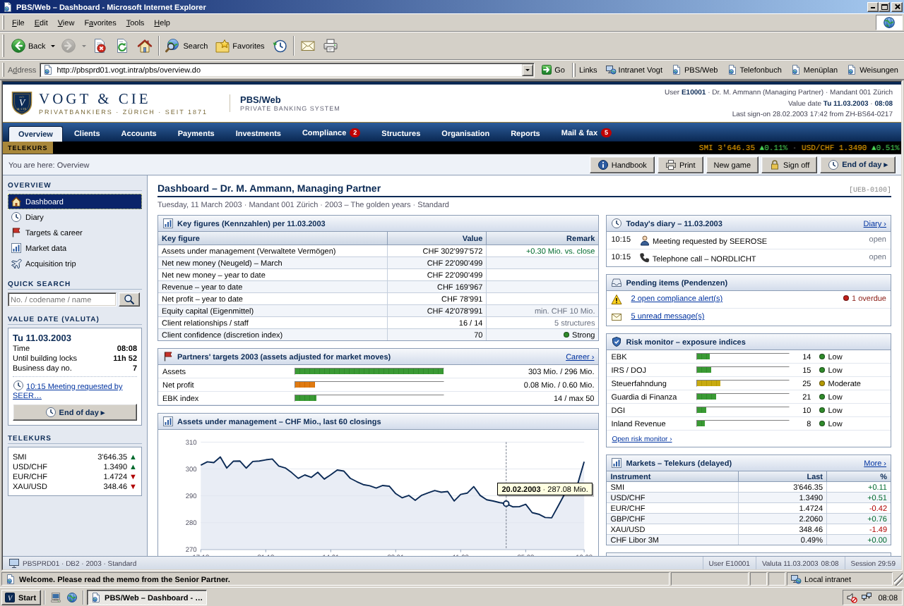
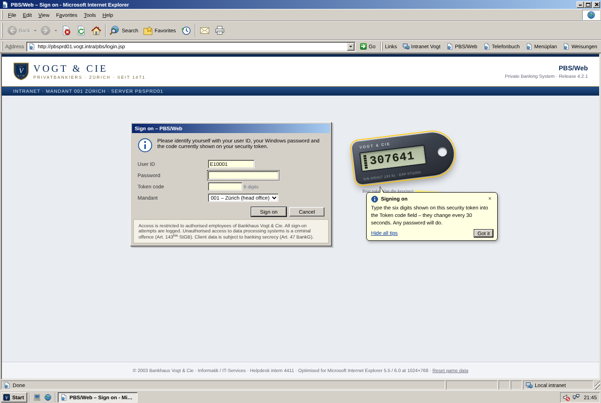
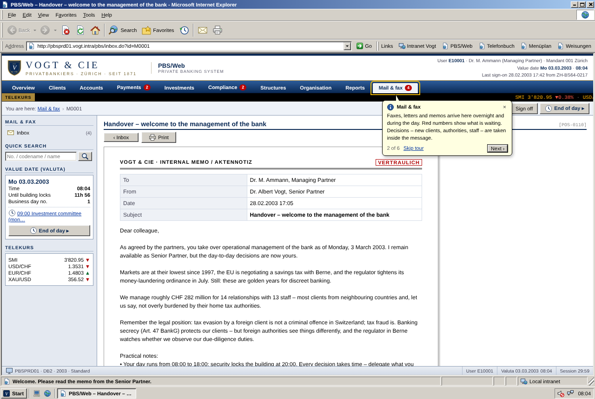

# PBS/Web – Bankhaus Vogt & Cie

A management game about the last twenty years of Swiss banking secrecy, dressed up as the intranet
of a small Zürich private bank on a Windows 2000 workstation. You are the new Managing Partner of
**Bankhaus Vogt & Cie** (founded 1871). You run the bank in "PBS/Web 4.2", its Private Banking
System, inside an Internet Explorer 6 window.

Your clients pay handsome fees to keep their money away from their home tax authorities. Grow the
bank, hit the partners' targets and build a private fortune, without losing the licence, getting
the bank indicted, or being arrested at an airport. The calendar runs on to the end of secrecy
in 2017.



## Running it

Plain HTML5, CSS and JavaScript: no build step, nothing to install.

- **Locally:** open `index.html` in a browser, or serve the folder with
  `python3 -m http.server 8000` and go to <http://localhost:8000>.
- **GitHub Pages:** enable Pages for the `main` branch (root folder) in the repository settings.

The game saves itself in the browser's `localStorage`. To start over, use **New game** in the
toolbar or **Reset game data** on the sign-on screen.

### Signing on



Any user ID and any password work. The **token code** is the six-digit number on the security
token next to the form; it changes every 30 seconds. On first sign-on you choose:

| Start year | Situation |
|---|---|
| **1998** – Secrecy at its peak | Money Laundering Act about to apply, euro a year away. Easy start, long road. |
| **2003** – The golden years | Markets at their low, EU savings tax being negotiated. The classic start. |
| **2008** – The storm is coming | Liechtenstein leak, US hunting Swiss bankers, Lehman six months away. Hard. |

and a difficulty: **Discreet**, **Standard** or **Hostile** (how fast authorities react and how
quickly clients leave).

### Tutorial



The game teaches itself with small yellow balloon tips in the Windows 2000 style. There is a hint
at the token on the sign-on screen, then a six-step tour of the screen on your first day. After
that, each area gets one tip the first time you open it: payments, cash desk, alerts, risk monitor,
client file, house view, staff, career, and your first appointment and first new day. Tips never
block the screen, disappear when you move on, and are shown only once. Switch them off with
**Hide all tips** or **Help › Tip of the Day**; **Help › Restart Tutorial** brings them back.

## The browser window

Everything happens inside an Internet Explorer 6 window on a Windows 2000 desktop:

- **Back, Forward, Refresh, Home**, the address bar (intranet URLs such as
  `http://pbsprd01.vogt.intra/pbs/client.do?id=100.482` can be typed in), the status bar with
  link targets and a page-load progress bar, and the "Local intranet" zone.
- **Menus**: View › Source opens the page in Notepad, View › Text Size zooms, F11 toggles full
  screen, Favorites and History work as Explorer bars, and Tools › Internet Options switches sound,
  animations and page transitions.
- The **Links** bar leads to the bank's intranet: telephone directory, canteen menu and internal
  directives (Weisungen), which follow the game's calendar.
- The **taskbar** shows the game clock. Click the speaker icon for volume and mute. The window can
  be minimised, restored, moved and closed; double-click *PBS/Web* on the desktop to reopen it.

Sounds (phone, fax, printer, navigation click) are synthesised with WebAudio; no audio files.

## How to play

### The working day

The office opens at 08:00 and closes at 18:00; security locks the building at 20:00. Every action
costs working time (shown as a clock badge). Overtime lowers staff morale. Appointments in the
**Diary** pop up when the clock reaches them: client reviews, calls, visits, the monthly investment
committee, the quarterly partners' meeting and trips abroad. Attend, delegate or postpone them.
**End of day** (F9) runs the batch job: markets move, fees and interest are booked and the next
morning brings new mail.

### What you manage

- **Clients** – client files with hold mail, Form A, structures, accounts and positions, file
  notes; new clients arrive through introducers. Clients have characters, families and lives
  (heirs, divorces, elections), and they compare their returns with the benchmark.
- **Payments** – faxed orders in the four-eyes release queue (SWIFT MT103, "ONE OF OUR CLIENTS"),
  internal transfers, the cash desk, and the courier service that brings cash across the border.
- **Products** – safe-deposit boxes and the vault, Lombard loans, back-to-back loans through
  correspondents abroad, offshore credit cards, booking centres in Nassau and Singapore.
- **Structures** – BVI and Panama companies, Liechtenstein foundations and Anstalten, Jersey and
  Cayman trusts, insurance wrappers.
- **Investments** – the house view for four strategies, trading intensity, house fund versus
  third-party funds (retrocessions), mandates, and own-account trading. Prices follow real market
  history from 1997 to 2017.
- **Compliance** – transaction monitoring alerts, requests for mutual assistance, investigations,
  defence counsel, lobbying, data security, the annual audit.
- **Organisation** – hire, pay, train, vet and dismiss staff; branches in Geneva and Lugano,
  representative offices, subsidiaries, the USD correspondent bank, acquisitions of other banks,
  and the fee schedule.
- **Reports** – profit and loss, assets by domicile, booking journal.

### Risk

The **Risk monitor** tracks attention from the Swiss regulator (EBK, later FINMA) and the tax
authorities of the US, Germany, Italy, France and the UK. Payments into home countries, mailed
statements, border checks, couriers, press reports, leaks and whistleblowers raise it; structures,
hold mail, booking abroad and good staff keep it down. High attention brings requests for
assistance, then **investigations** that advance through raids and arrests to an indictment.
Until the revised tax treaties (2010–2016) assistance can be refused for tax evasion, but not for
tax fraud. Your **personal exposure** grows with the special services you approve yourself.

### History

The game runs on a real calendar: the Money Laundering Act (1998), the euro, the US Qualified
Intermediary rules, the EU savings tax (2005), the Liechtenstein data leak and the UBS case
(2008), the bought data CDs, the Rubik agreements, the US programme for Swiss banks (2013), FATCA,
the end of the euro floor (2015), the Panama Papers (2016) and automatic exchange of information
(2017).

### Endings and score

Each January the partners judge you on assets, profit and regulatory attention. Your bonus goes
into a private numbered account. Retire rich, sell the bank, or reach 2018. Alternatively, be
fired, lose the licence, see the bank indicted, or be arrested. The final fortune and how you got
there make the score, kept in a local hall of fame.

## Project structure

```
index.html           Desktop, browser window, sign-on screen, application frame, icon sprite
css/pbs.css          Windows 2000 / IE6 chrome, intranet look, balloon tips, print styles
js/util.js           Swiss number and date formatting, business days, IBAN check digits
js/data/             Bank and laws, staff and names, clients, markets, timeline, start scenarios
js/engine/           Game rules: kernel (state, time, saving), market, payments, clients, staff,
                     expansion, authorities, career, agenda, events, end-of-day batch, setup
js/views/            Screens; they only read the game state
js/sound.js          Synthesised sounds
js/browser.js        Browser window, menus, toolbars, explorer bars, taskbar, dialogs
js/tutorial.js       Balloon tips and the first-day tour
js/app.js            Sign-on, routing, appointments, forms, actions and the batch console
```

All changes go through `PBS.Game`; views never change the state. Balancing numbers (fees,
thresholds, exposure factors, event weights, difficulty levels) are in `js/data/` and near the
top of the relevant engine modules.

## Disclaimer

This is a game and a satire of a real chapter of financial history. All banks, persons, companies,
BICs and account numbers are fictitious. Swiss law, institutions and historical events are
simplified. Nothing here is legal or tax advice.
